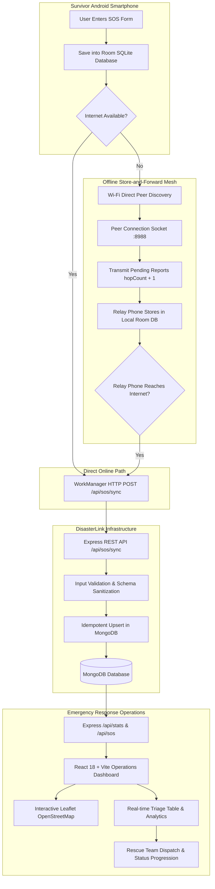
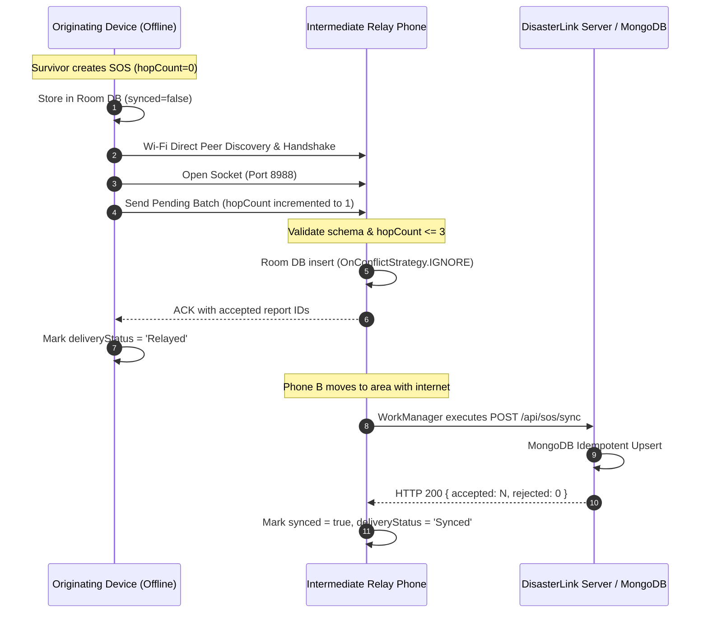
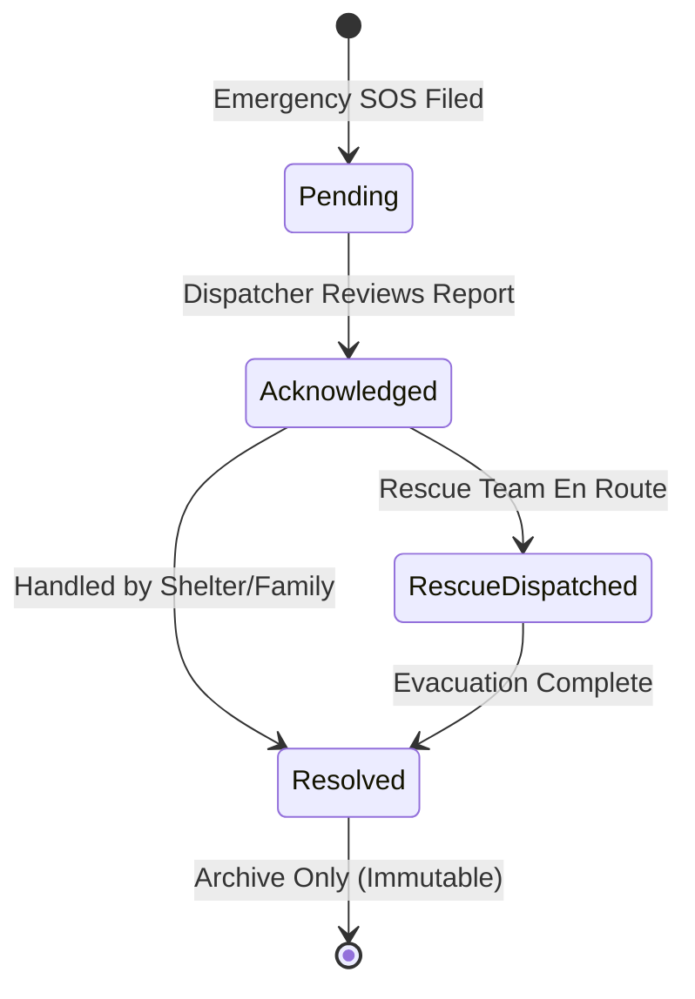

# DisasterLink System Architecture

## 1. System Overview

**DisasterLink** is an emergency flood response and SOS coordination prototype engineered to provide reliable emergency communication during severe disasters, specifically addressing extreme scenarios where municipal power grids, cellular infrastructure, and mobile internet are impaired or completely offline.

The system integrates three core components:
1. **Central Emergency Operations Dashboard (Web)**: A high-visibility, dark navy operations center web application built with React, Vite, Leaflet OpenStreetMap, and Recharts for rescue operators to triage, map, and dispatch rescue assets.
2. **Backend API & Database (Node.js / Express / MongoDB)**: An idempotent, RESTful service managing persistent emergency records, state transitions, spatial indexing, aggregate analytics, and bulk offline report synchronization.
3. **Android SOS Mobile Application (Kotlin / Room / Wi-Fi Direct)**: A mobile client enabling trapped citizens to store SOS reports locally on-device, relay reports opportunistically to nearby compatible smartphones via Wi-Fi Direct (store-and-forward), and automatically synchronize with the central server via WorkManager when network connectivity is restored.

---

## 2. End-to-End Data Flow

---

## 3. Component Architecture

### 3.1 Web Operations Dashboard (`/dashboard`)
* **Technology**: React 18, Vite, Recharts, Leaflet, OpenStreetMap.
* **Architecture**: Modular component-driven control room interface:
  * `SummaryMetrics.jsx`: Real-time KPI summary (Total, Active, Awaiting Assistance, Resolved, Relayed).
  * `IncidentMap.jsx`: Geospatial cluster visualization with automatic bounding, OpenStreetMap tiles, and status-coded pulse markers.
  * `AnalyticsCharts.jsx`: Emergency pipeline distribution and 7-day inflow timeline.
  * `ReportsTable.jsx`: Fast triage queue with search, multi-field filtering, sorting, CSV export, and valid status transition enforcement.
  * `ReportDetailModal.jsx`: Emergency dossier with detailed telemetry (relay hop count, delivery pathway, OpenStreetMap links).
  * `CreateSOSModal.jsx`: Hotline/radio incident logging interface with browser GPS integration.
  * `DemoModeBanner.jsx`: Explicit simulation banner and 1-click MongoDB seeding/exercise runner.
* **Environment Configuration**: Configured via Vite environment variables (`VITE_API_BASE_URL`).

### 3.2 Backend API Service (`/backend`)
* **Technology**: Node.js, Express.js, MongoDB, Mongoose, CORS, Dotenv.
* **Key Design Principles**:
  * **Idempotency**: Submissions with identical `reportId` return the existing record without data corruption or duplicate primary keys.
  * **Fault Isolation**: Batch `/api/sos/sync` handles up to 100 records per batch in parallel. Malformed individual records return an error response without aborting valid sibling reports.
  * **Input Validation**: Strict type, string length, and geospatial coordinate constraints (Latitude \[-90, 90], Longitude \[-180, 180]).
  * **State Machine Validation**: Rejects invalid operational transitions (e.g. attempting to reopen a Resolved report).

### 3.3 Android SOS Application (`/android-app`)
* **Technology**: Kotlin, Android SDK 35 (minSdk 23), Room ORM, Android WorkManager, Wi-Fi Direct (`WifiP2pManager`).
* **Modular Screen Navigation**:
  1. **Home**: High-contrast emergency trigger, device status, and quick triage shortcuts.
  2. **Send SOS**: Form capture with multiline description, category, people count, landmark, and optional GPS fix.
  3. **History**: Offline Room record viewer displaying synchronization state and relay hops.
  4. **Nearby Relay**: Wi-Fi Direct peer discovery and manual peer connection trigger.
  5. **Sync Status**: WorkManager telemetry and network connection monitor.
  6. **Safety & Guidance**: Crucial disclaimers, flood survival instructions, and emergency hotlines.

---

## 4. Offline Store-and-Forward Protocol

### Loop Prevention & Security Rules:
1. **Hop Count Cap**: Reports are limited to a maximum of 3 hops (`hopCount <= 3`). Reports exceeding 3 hops are dropped from relaying to prevent broadcast storms.
2. **Batch & Packet Caps**: Maximum transmission size is capped at 128 KB per Wi-Fi Direct socket burst, and maximum 50 reports per batch.
3. **Socket Timeouts**: Strict 20-second timeout on socket connect, read, and accept operations.
4. **Idempotent Primary Keys**: Every report generates a stable UUID upon initial creation (`reportId`). Intermediate nodes cannot mutate the original `reportId` or `createdAt` timestamp.

---

## 5. Status Transition State Machine

| Source Status | Permitted Next Statuses | Rationale |
| :--- | :--- | :--- |
| **Pending** | `Acknowledged` | Ensures an operator has actively reviewed the incoming queue. |
| **Acknowledged** | `Rescue Dispatched`, `Resolved` | Resources can be deployed or verified cleared. |
| **Rescue Dispatched** | `Resolved` | Incident remains open until field team reports resolution. |
| **Resolved** | None | Terminal state. Closed records are locked from further mutation. |

---

## 6. Security and Privacy Considerations

* **No Mandatory PII**: Citizens are not required to provide personal identifying information (real name, phone number, national identity).
* **Location Access Control**: GPS location is strictly optional. Users can decline location permission and submit landmark text descriptions instead.
* **CORS & Rate Limiting**: Backend CORS origins are restricted to configured development and production hostnames.
* **Database Parameter Safety**: All MongoDB queries are executed via Mongoose schemas with typed sanitization, preventing NoSQL injection.
* **Production Roadmap**: Production deployments require JWT role-based access control (RBAC) on `/status` endpoints, TLS transport encryption on all socket relays, and API gateway rate-limiting.

---

## 7. Safety Limitations & Disclaimers

> [!CAUTION]
> **Prototype Limitations**: DisasterLink is an academic engineering prototype. It does not replace municipal 911/112 emergency services.
> 1. A report saved on a smartphone is **not guaranteed** to have reached first responders until status confirmation is received from the central server.
> 2. Wi-Fi Direct peer discovery depends on hardware compatibility, Android version permissions, and physical proximity (typically 15–50 meters).
> 3. Citizens in immediate physical danger must prioritize physical evacuation to high ground and utilize official emergency channels whenever available.
